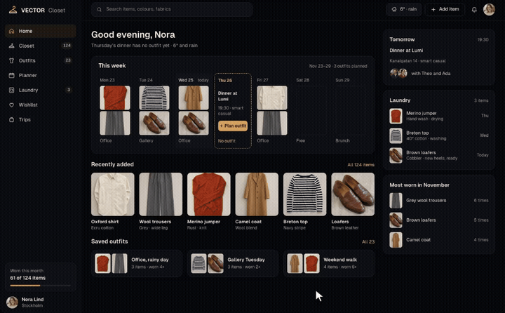

# Outfit Set

**Thursday dinner and still no outfit? Drag the shirt onto the trousers.**



**Live demo:** [veraetogrex-portfolio.github.io/outfit-set](https://veraetogrex-portfolio.github.io/outfit-set/) · **Mockup:** [full-screen version](https://veraetogrex-portfolio.github.io/outfit-set/mockup/outfit-set.html)

A wardrobe outfit board: drag a shirt onto the trousers with real pointer events, the coat and loafers step aside, the trousers make room, and the pieces fold into one outfit card saved to Thursday. Vanilla HTML/CSS/JS, zero dependencies.

## Try it

- Press Plan outfit on Thursday, the only day of the week without an outfit. The outfit board opens: the oxford shirt marked Best match, the grey wool trousers, the camel coat and the brown loafers.
- Press and hold the shirt. It lifts with a slight tilt, a shadow and a camel outline; the coat and the loafers step back to the edge of the board and "Top goes here" appears over the trousers.
- Drag it over the trousers. They sink to take the shirt and the hint changes to "Release to pair the shirt with the trousers". Let go anywhere else and the shirt slides back to its place.
- Let go over the trousers. The shirt, the trousers and the loafers fold into one card "Thu · Dinner at Lumi", the button turns into "Saved to Thursday", Outfits counts 23 → 24 and Thursday in This week shows the shirt.
- Keyboard: Tab to the shirt, Enter or Space pairs it with the trousers.
- With reduced motion on, the lift, the step aside and the trousers sinking happen at once; the fold into the card still plays.

## Use it

Three files and the photos, no build step, no dependencies:

```
index.html   markup
style.css    styles
script.js    logic
assets/      the photos (generated, free to reuse with the code)
```

Download the repo and open `index.html`, or copy the files into your project. Set `data-assets` on `<section class="vc">` to the folder with your photos.

## License

MIT
